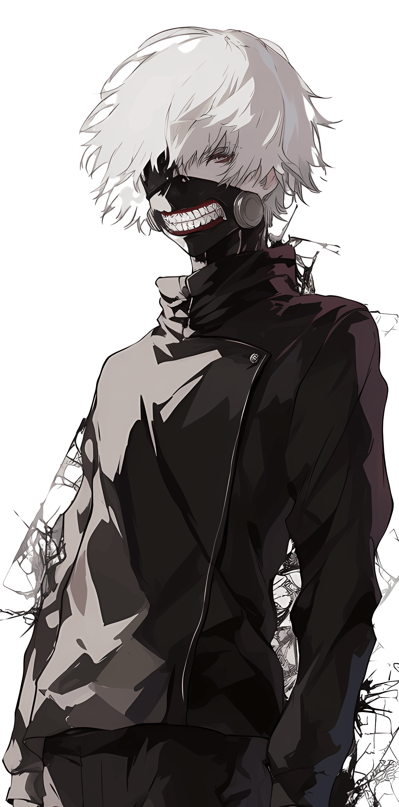

   
  

 

  
  
  

  

---

<table align="center" width="100%">
  <tr>
    <td align="center" valign="middle" width="35%">
      
    </td>
    <td valign="middle" width="65%">
<h3><code>jasmin@arch~></code>whoami⚡</h3>
<pre>
┌── [ SYSTEM DIAGNOSTICS ] ─────────────────────────┐
│ • User      › Jasmin (jasmin1727)                 │
│ • OS        › Arch Linux (Hyprland / Wayland)     │
│ • Shell     › Fish Terminal                       │
│ • Editor    › Neovim                              │
│ • Core      › C · C++ · Go · Rust · Python        │
│ • AI/ML     › Deep Learning · PyTorch · Kaggle    │
│ • Mindset   › Intellectual Omnivore               │
└───────────────────────────────────────────────────┘
</pre>
<blockquote>
<i>"Fall, learn, build, rise — and never stop exploring."</i>
</blockquote>
<h4>✦ What I'm Building &amp; Exploring</h4>
<ul>
  <li>🔥 <b>Low-Level Systems</b>: Writing fast, memory-safe software with C, C++, and Rust</li>
  <li>🧠 <b>Deep Learning &amp; AI</b>: Researching architectures, training models, and experimenting on Kaggle &amp; Colab</li>
  <li>💻 <b>Custom Unix Environment</b>: Minimalist workflow driven by Arch Linux, Hyprland, and Neovim</li>
  <li>🚀 <b>Open Source</b>: Always building CLI utilities, backend architectures, and developer tooling</li>
</ul>
</td>
  </tr>
</table>

<!-- ---

  

 

--- -->

<h2 align="center"> Languages-Frameworks-Tools </h2>
 

<table align="center">
  <tr>
    <td align="center" width="96">
      
    </td>
    <td align="center" width="96">
      
    </td>
    <td align="center" width="96">
      
    </td>
    <td align="center" width="96">
      
    </td>
    <td align="center" width="96">
      
    </td>
    <td align="center" width="96">
      
    </td>
  </tr>

  <tr>
    <td align="center" width="96">
      
    </td>
    <td align="center" width="96">
      
    </td>
    <td align="center" width="96">
      
    </td>
    <td align="center" width="96">
      
    </td>
    <td align="center" width="96">
      
    </td>
    <td align="center" width="96">
      
    </td>
  </tr>

  <tr>
    <td align="center" width="96">
      
    </td>
    <td align="center" width="96">
      
    </td>
    <td align="center" width="96">
      
    </td>
    <td align="center" width="96">
      
    </td>
    <td align="center" width="96">
      
    </td>
    <td align="center" width="96">
      
    </td>
  </tr>
</table>

 

<!-- 

  

 -->

